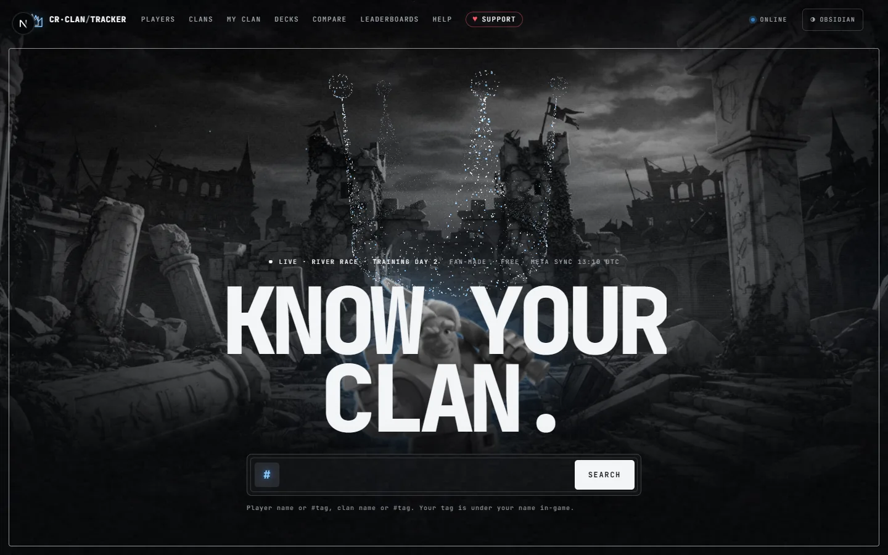
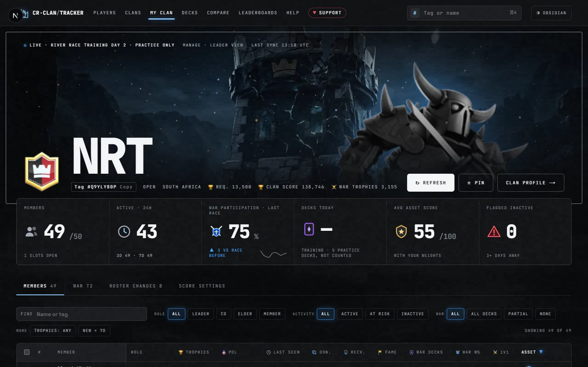
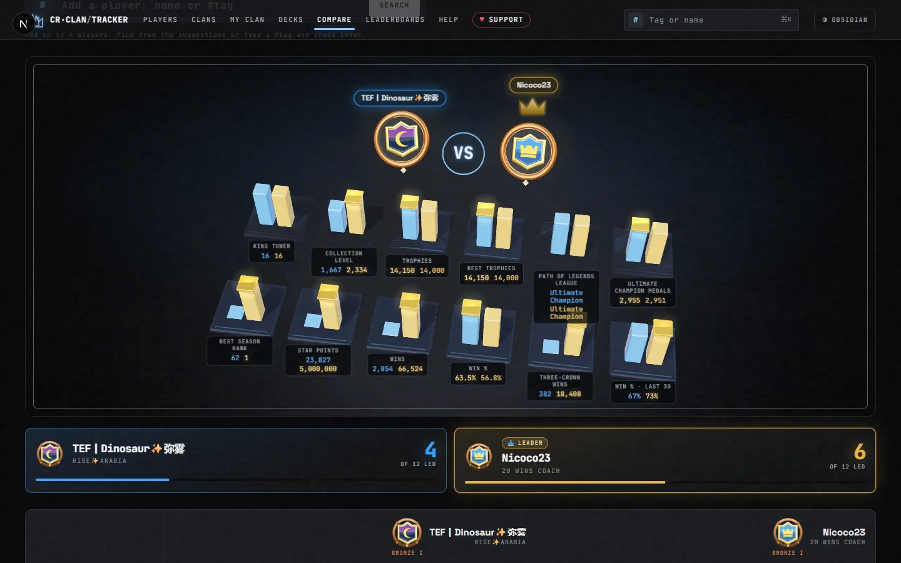
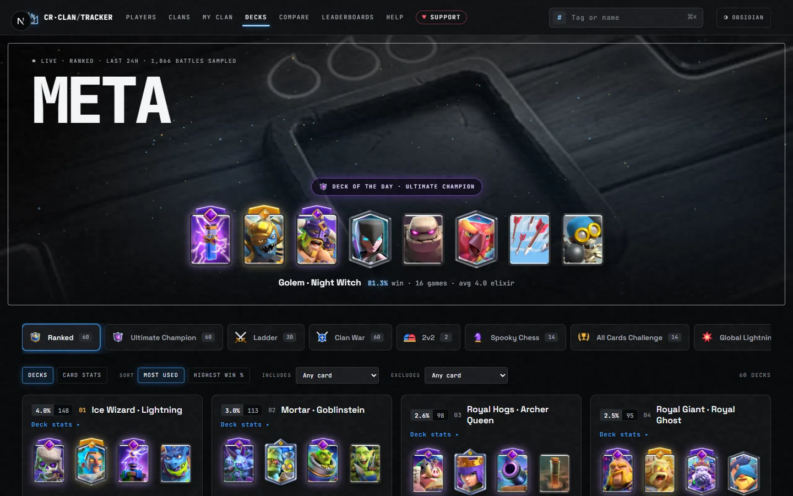
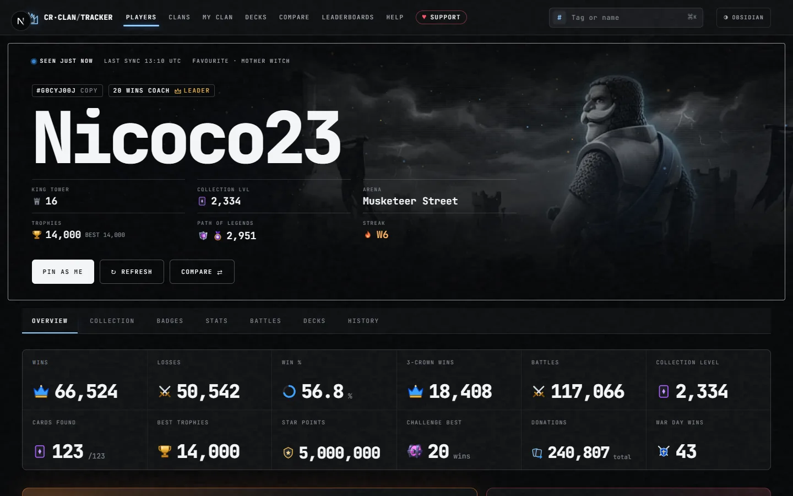
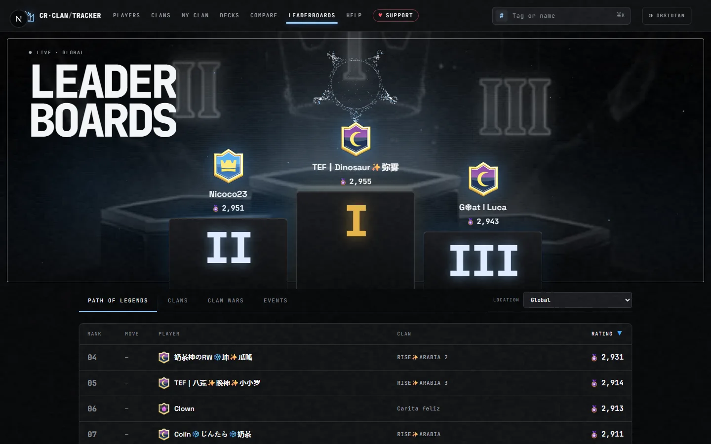
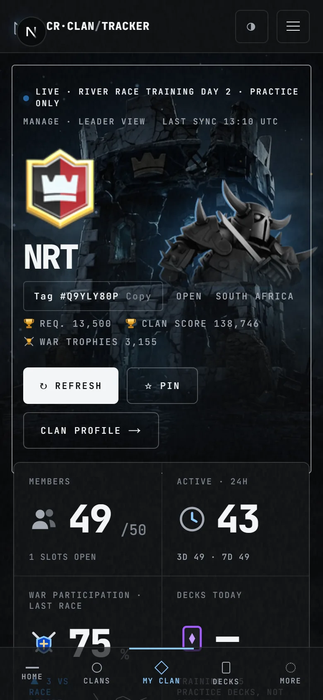

<div align="center">

# CR Clan Tracker

**Clash Royale stats and clan management, in one place.**

Look up any player or clan, see the live meta, and run your clan with real numbers:
who's active, who plays war, and who's earned a promotion.

[**cr-clan-tracker.vercel.app**](https://cr-clan-tracker.vercel.app)




</div>

## Features

- **Clan dashboard.** Every member with an Asset Score, activity, war decks per day, donations and roster changes. Filter, sort, compare, export to CSV and tune the score weights to how your clan plays.
- **Player profiles.** Stats, current win streak, the last 30 battles, worst enemy, current deck with evolutions and heroes, full collection, badges and trophy history.
- **Clan profiles.** Members with collection levels, the live river race, war history and who joined or left.
- **Meta decks.** The most used and best performing decks in every game mode from the last 24 hours, built from the battle logs of the top Path of Legends players, with matchups and card stats.
- **Compare.** Up to four players or clans side by side in a 3D showdown, with every stat and who leads it.
- **Leaderboards.** Path of Legends, clan trophies, clan wars and events, global or by country.
- **Search everything.** One box finds player names, player tags, clan names and clan tags.
- **Made for every screen.** Phone, tablet and desktop layouts, a dark "Obsidian" theme and a light "Marble" theme.

## Screenshots

| Clan dashboard | Compare |
|---|---|
|  |  |
| **Meta decks** | **Player profile** |
|  |  |
| **Leaderboards** | **On a phone** |
|  |  |

## How it works

- **Official data.** Everything comes live from the official Clash Royale API, through the [RoyaleAPI proxy](https://docs.royaleapi.com/proxy.html) so the host's IP never needs allow-listing.
- **History the API doesn't have.** Roster changes, per-day war decks, trophy trends and join dates come from snapshots stored in Postgres every 30 minutes. Without a database the site still works.
- **Meta decks the API doesn't have.** Built every hour from the battle logs of the global Path of Legends top players, counted per mode.
- **Fast by design.** Pages render instantly from cache (Next.js Cache Components) and stream in anything slow; repeat visits load in well under 0.2 s. The 3D scenes load in their own chunk once the browser is idle.
- **Gentle on the API.** A shared token-bucket limiter paces every call, and visitors get per-IP limits on pages and endpoints, so nobody can burn through the key.
- **Locked down.** Strict security headers (CSP, HSTS, no framing), secrets only on the server, constant-time checks for scheduled jobs, and an image proxy that only talks to the official asset host.
- **Never just an error.** If the host is down, a service worker shows a self-contained outage page and tells visitors when the site is back.

## Tech stack

| | |
|---|---|
| Framework | Next.js 16 (App Router, Cache Components, partial prerendering), React 19, TypeScript |
| 3D and motion | three.js (particle crowns, the Compare showdown, river race), CSS animation |
| Data | Official Clash Royale API, PostgreSQL with Drizzle ORM (embedded PGlite for local development) |
| Testing | Vitest (unit, component and live-data accuracy tests), Playwright (desktop and phone end-to-end) |
| Hosting | Vercel, Supabase Postgres, GitHub Actions for the scheduled snapshots |

## Running it locally

1. Get an API key from [developer.clashroyale.com](https://developer.clashroyale.com) with allowed IP `45.79.218.79` (the RoyaleAPI proxy).
2. Copy `.env.example` to `.env` and paste in your key. For history without a database server, also set:
   ```
   DATABASE_URL=pglite:./.data/pg
   CRON_SECRET=any-long-random-string
   ```
3. Install and run, then open http://localhost:3000:
   ```bash
   npm install
   npm run dev
   ```

| Command | What it does |
|---|---|
| `npm test` | Unit and component tests |
| `npm run test:data` | Live accuracy: recomputes clan, player, meta and search data and checks every number against the raw API |
| `npm run test:e2e` | Every page on desktop and phone: loads without errors or sideways scroll, flows work, numbers match the API |
| `npm run typecheck` · `npm run lint` | Types and lint |

## Deploying

Any Node host works. Set `CR_API_KEY`, `CR_API_BASE`, `DATABASE_URL` (a hosted Postgres; use a transaction pooler on serverless hosts) and `CRON_SECRET`, then call `/api/cron/snapshot` and `/api/cron/directory` every 30 minutes with `Authorization: Bearer $CRON_SECRET`. The included GitHub Actions workflow does this once the `SITE_URL` and `CRON_SECRET` repository secrets are set.

Optional: `NEXT_PUBLIC_DONATE_URL` adds a donate button to the error and outage pages, and `SITE_DOWN=1` puts the whole site into maintenance mode.

## Disclaimer

This content is not affiliated with, endorsed, sponsored, or specifically approved by Supercell and Supercell is not responsible for it. For more information see [Supercell's Fan Content Policy](https://www.supercell.com/fan-content-policy).

© 2026 A12SPARTAN117. All rights reserved.
